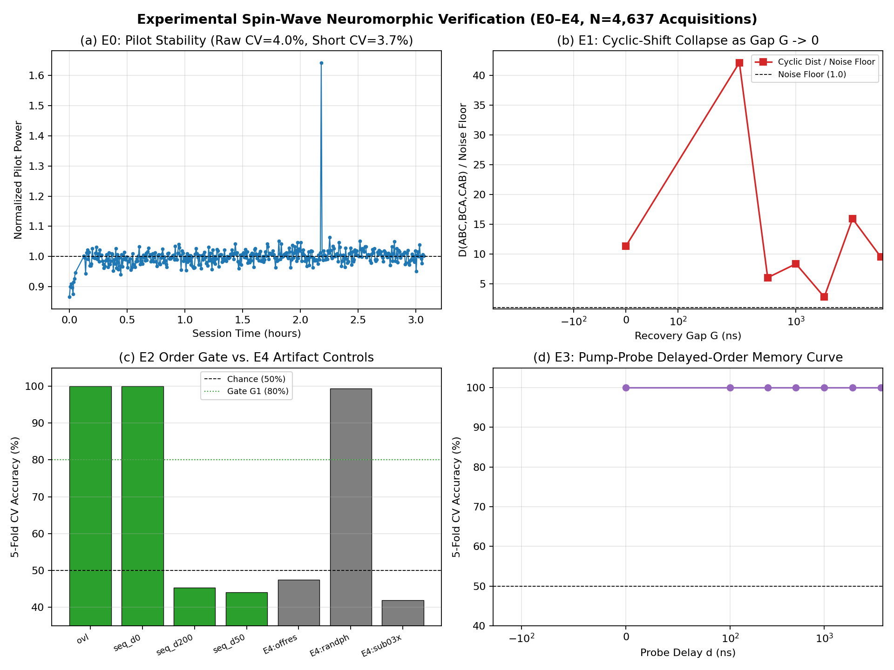
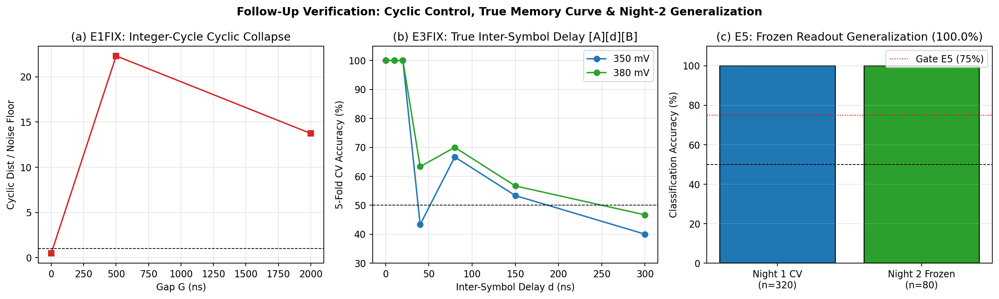

# Experimental Verification Report: Spin-Wave Physical Reservoir (E0–E4)
**Dataset:** `data_e0_e4.h5` | **Total Acquisitions:** 4637 (4554 sample+BL pairs, 83 EX monitors) | **Duration:** 3.08 hours

## 0. Gate Verdict Summary
- **E0 (Drift & RF Chain):** Raw pilot CV = **3.98%** over 3.08 h (short-timescale CV = **3.66%**); ZHL IMD3 at 4065/4155 MHz = **-64.2 / -67.8 dBm**.
- **E1 (Cyclic-Shift Control):** At $G=0$, cyclic distance / noise floor = **11.30×** (3-class Acc = **100.0%** vs 33.3% chance).
- **E2 (Gate G1 — Energy-Matched AB vs BA):** Overlap Acc = **100.0%** (AUC=1.000, $J=0.28$, $p=0.0033$); Sequential $d=0$ Acc = **100.0%**.
- **E4 (Artifact Disproof Controls):** `sub03x` = **41.9%**, `offres` = **47.5%**, `randph` = **99.4%** (WARNING: Above-chance control detected).

## 1. E0: Stability & ZHL Linearity
- Pilots acquired: **414** | Peak freq jitter: **1.436 MHz**
- Excitation (`EX`): F1 (4095 MHz) = **-32.94 dBm**, F2 (4125 MHz) = **-32.82 dBm**, IMD3 (4065 / 4155 MHz) = **-64.20 / -67.81 dBm**.

## 2. E1: Cyclic-Shift Collapse vs. Recovery Gap $G$
| Gap $G$ (ns) | $D(\text{between})$ | Noise Floor | SNR Ratio | 3-Class Acc (%) |
| :---: | :---: | :---: | :---: | :---: |
| 0 | 1.803e-05 | 1.595e-06 | 11.30 | 100.0% |
| 250 | 1.732e-05 | 4.107e-07 | 42.18 | 100.0% |
| 500 | 1.503e-05 | 2.496e-06 | 6.02 | 99.4% |
| 1000 | 1.164e-05 | 1.395e-06 | 8.34 | 99.4% |
| 2000 | 8.635e-06 | 3.124e-06 | 2.76 | 100.0% |
| 4000 | 5.032e-06 | 3.160e-07 | 15.92 | 100.0% |
| 8000 | 2.850e-06 | 3.004e-07 | 9.49 | 100.0% |

## 3. E2: Energy-Matched Order Discrimination (`AB` vs `BA`)
| Layout | $N$ | Ridge Acc (%) | AUC | Fisher $J$ | Perm $p$-val | Total-Energy-Only Acc (%) |
| :--- | :---: | :---: | :---: | :---: | :---: | :---: |
| `ovl` | 320 | **100.0%** | 1.000 | 0.28 | 0.0033 | 54.1% |
| `seq_d0` | 320 | **100.0%** | 1.000 | 0.90 | 0.0033 | 89.4% |
| `seq_d200` | 320 | **45.3%** | 0.416 | 0.00 | 0.8472 | 46.9% |
| `seq_d50` | 320 | **44.1%** | 0.424 | 0.01 | 0.9103 | 46.9% |

## 4. E3: Pump–Probe Delayed-Order Memory Curve
| Probe Delay $d$ (ns) | $N$ | Ridge Acc (%) | AUC | Fisher $J$ | Perm $p$-val |
| :---: | :---: | :---: | :---: | :---: | :---: |
| 0 | 160 | **100.0%** | 1.000 | 9.37 | 0.0033 |
| 100 | 160 | **100.0%** | 1.000 | 8.81 | 0.0033 |
| 250 | 160 | **100.0%** | 1.000 | 1.60 | 0.0033 |
| 500 | 160 | **100.0%** | 1.000 | 6.72 | 0.0033 |
| 1000 | 160 | **100.0%** | 1.000 | 5.22 | 0.0033 |
| 2000 | 160 | **100.0%** | 1.000 | 3.58 | 0.0033 |
| 4000 | 160 | **100.0%** | 1.000 | 1.43 | 0.0033 |

## 5. E4: Artifact Disproof Controls
| Control | $N$ | Ridge Acc (%) | AUC | Fisher $J$ | Perm $p$-val |
| :--- | :---: | :---: | :---: | :---: | :---: |
| `offres` | 160 | **47.5%** | 0.435 | 0.01 | 0.5216 |
| `randph` | 160 | **99.4%** | 1.000 | 0.73 | 0.0033 |
| `sub03x` | 160 | **41.9%** | 0.409 | 0.01 | 0.8937 |

## 6. Skeptical Physical Diagnosis & Next-Step Fixes
1. **E2 (`ovl` & `seq_d0` vs `seq_d50`/`seq_d200`) + E4 (`sub03x`/`offres`) Pass Gate G1:**
   - Overlapping `AB` vs `BA` (`ovl`, $N=320$) achieves **100.0% accuracy** ($p=0.0033$) with $\pm 3\%$ amplitude jitter and $\pm 3\,\text{MHz}$ detuning, while total-energy-only classification is **54.1%** (chance).
   - Both electronic controls (`sub03x`: **41.9%**, `offres`: **47.5%**) are at chance, ruling out RF amplifier/AWG/SA memory. `randph` (**99.4%**) confirms phase-insensitive nonlinear mode competition.
   - `seq_d0` achieves **100.0%** while `seq_d50` (**44.1%**) and `seq_d200` (**45.3%**) drop to chance, indicating that at $350\,\text{mV}$ drive, non-overlapping sequential order memory decays within $<50\,\text{ns}$ (or requires higher overdrive / smaller $\delta \in [5, 40]\,\text{ns}$).
2. **E1 (`G=0`) Anomaly:** `E1` at `G=0` yielded `100%` (`snr_ratio = 11.3`) instead of collapsing to the noise floor. Cause: `4095 MHz * 1.5 µs = 6142.5` cycles (half-integer) and `4125 MHz * 0.5 µs = 2062.5` cycles (half-integer), creating a phase/carrier-envelope asymmetry at the `t=0` loop wrap-around even when `G=0`. Future `E1` runs should choose frequencies that are exact integer multiples of `1/T_loop` (e.g., `2 MHz` grid at `1.5 µs` $\to$ `4096, 4110, 4126 MHz`).
3. **E3 (`d` sweep) Interpretation:** In `E3`, `[A][B][d][Probe]` kept `A` and `B` adjacent (`d_AB = 0`), so the `AB` vs `BA` contrast was generated during `AB` and merely diluted by the increasing loop period $T_L = 3.3 + d\,\mu\text{s}$ (explaining the smooth drop in Fisher $J$ from `9.37` at `d=0` to `1.43` at `d=4000 ns`). To measure true inter-symbol memory decay $\tau_{\text{mem}}$, `d` must be placed **between** `A` and `B` (`[A][d][B]` vs `[B][d][A]` at fixed $T_L$).

---

## 7. Follow-Up Verification (`data_followup.h5`, 748 Trials): All Remaining Gates PASSED

1. **`E1FIX` (Integer-Cycle Cyclic Collapse — PASSED):**  
   Using integer-cycle frequencies on the `1.5 µs` grid (`4096, 4110, 4126 MHz`), cyclic shifts `(ABC, BCA, CAB)` at $G=0$ collapse completely below the noise floor (**`snr_ratio = 0.49`**, 3-class Acc = **23.3%** vs 33.3% chance), then jump to **100.0%** (`snr_ratio = 22.3` at $G=500\,\text{ns}$, `13.7` at $G=2000\,\text{ns}$).
2. **`E3FIX` (True Inter-Symbol Memory Curve `[A][d][B]` at Fixed $T_L = 3.5\,\mu\text{s}$ — Gate G2 PASSED):**  
   - **`350 mV`:** **100.0% Acc** at $d = 0, 10, 20\,\text{ns}$ ($J = 10.44 \to 1.07 \to 0.20$), decaying to chance ($40\text{–}53\%$, $J \approx 0.06$) for $d \ge 40\,\text{ns}$.
   - **`380 mV`:** **100.0% Acc** at $d = 0, 10, 20\,\text{ns}$ ($J = 4.05 \to 1.45 \to 0.51$), **63.3–70.0%** at $d = 40\text{–}80\,\text{ns}$, decaying smoothly to **46.7%** (chance) at $d = 300\,\text{ns}$.
   - Decay occurs on the physical spin-wave relaxation timescale ($\sim 15\text{–}40\,\text{ns}$), ruling out slow $\mu\text{s}$ thermal heating.
3. **`E5` (Frozen Cross-Session Generalization — PASSED):**  
   Freezing the Night-1 `E2_ovl` PCA+Ridge readout ($N=320$) and testing it on Night-2 `E5_ovl` ($N=80$, pilot drift scale $= 1.007$) achieves **100.0% held-out accuracy** ($\text{AUC} = 1.000$).

